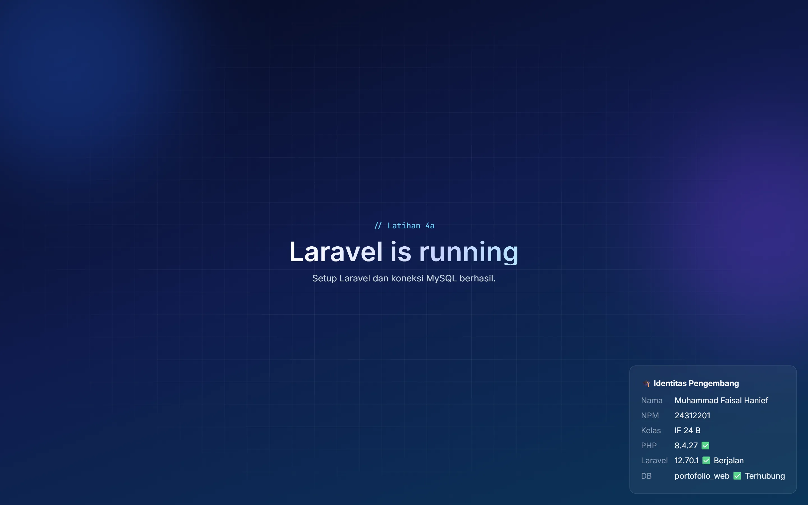

# Portfolio Website

Personal portfolio website of **Muhammad Faisal Hanief**, an Informatics student at Universitas Teknokrat Indonesia. Built with Laravel 12, Tailwind CSS v4, and MySQL. The skills and projects shown on the page are loaded from the site's own REST API.

> Live demo: coming soon

## Features

- Responsive dark design with a gradient background, scroll animations, typing effect, and a cursor spotlight on project cards
- Sections: Hero, About, Skills, Projects, Education, and Contact
- Skills and projects are loaded from a REST API (Laravel + MySQL), with loading and error states
- Contact form that saves messages to the database (rate limited)
- Token-based admin API (Laravel Sanctum) to manage projects and read messages
- Placeholder buttons for links that are not ready yet (CV, LinkedIn, project GitHub and demo links)

## Tech stack

Laravel 12 · PHP 8.2+ · MySQL · Tailwind CSS v4 · Vite · Vanilla JavaScript · Laravel Sanctum

## Getting started

Requirements: PHP 8.2+, Composer, Node.js 20.19+ (or 22.12+), and MySQL.

```bash
git clone https://github.com/Faisal-Hanief/portfolio.git
cd portfolio
composer install
npm install
cp .env.example .env        # on Windows: copy .env.example .env
php artisan key:generate
```

Create an empty MySQL database named `portofolio_web` and check the `DB_*` values in `.env`. Then set:

- `ADMIN_EMAIL` and `ADMIN_PASSWORD` for the admin account (use a strong, unique password)
- `PORTFOLIO_EMAIL`, `PORTFOLIO_GITHUB`, `PORTFOLIO_WHATSAPP`, `PORTFOLIO_LINKEDIN`, and `PORTFOLIO_CV` for the contact buttons (leave a value empty to show that button as "soon")

```bash
php artisan migrate --seed
npm run dev
```

Open the site in your local web server (for example Laragon, or `php artisan serve`).

## API

| Method              | Endpoint                          | Access                | Description                               |
| ------------------- | --------------------------------- | --------------------- | ----------------------------------------- |
| GET                 | `/api/projects`                   | Public                | List published projects with their skills |
| GET                 | `/api/projects/{slug}`            | Public                | Show one project                          |
| GET                 | `/api/skills`                     | Public                | Skills grouped by category                |
| GET                 | `/api/stats`                      | Public                | Project and skill counts                  |
| POST                | `/api/contact`                    | Public (5 per minute) | Save a contact message                    |
| POST                | `/api/login`                      | Public (5 per minute) | Get an admin token                        |
| POST                | `/api/logout`                     | Token                 | Revoke the current token                  |
| POST, PATCH, DELETE | `/api/projects`                   | Token                 | Create, update, and delete projects       |
| GET                 | `/api/contact-messages`           | Token                 | Read contact messages                     |
| PATCH               | `/api/contact-messages/{id}/read` | Token                 | Mark a message as read                    |

Admin endpoints need an `Authorization: Bearer <token>` header. Tokens expire after one day.

## Notes

- Never commit your `.env` file. Use `.env.example` as the template.
- After changing CSS or JavaScript for production, run `npm run build`.

## Dokumentasi Latihan 4a — Setup Laravel

### 1. Versi PHP dan Laravel

Project ini menggunakan:

- **PHP 8.4.27** — digunakan sebagai bahasa pemrograman utama Laravel. Versi ini dipilih karena memenuhi kebutuhan project dan kompatibel dengan lingkungan pengembangan yang digunakan.
- **Laravel 12.70.1** — digunakan sebagai framework PHP untuk membangun aplikasi web. Laravel menyediakan struktur aplikasi, routing, controller, migration, seeder, dan fitur keamanan yang membantu proses pengembangan.

### 2. Struktur Folder Laravel

Berikut lima folder utama Laravel beserta fungsinya:

| Folder       | Fungsi                                                                          |
| ------------ | ------------------------------------------------------------------------------- |
| `app/`       | Menyimpan kode utama aplikasi, seperti Controller, Model, dan layanan aplikasi. |
| `bootstrap/` | Berisi file untuk proses awal atau bootstrap aplikasi Laravel.                  |
| `config/`    | Menyimpan berbagai konfigurasi aplikasi, seperti database dan layanan lainnya.  |
| `database/`  | Menyimpan migration, seeder, dan factory untuk pengelolaan database.            |
| `resources/` | Menyimpan file tampilan Blade, CSS, dan JavaScript.                             |
| `routes/`    | Menyimpan definisi alamat atau routing aplikasi.                                |
| `public/`    | Menjadi folder utama yang dapat diakses oleh browser dan menyimpan aset publik. |

### 3. Perintah Artisan

Berikut beberapa perintah Artisan yang digunakan dalam pengembangan Laravel:

| Perintah                     | Fungsi                                                               |
| ---------------------------- | -------------------------------------------------------------------- |
| `php artisan list`           | Menampilkan daftar perintah Artisan yang tersedia.                   |
| `php artisan about`          | Menampilkan informasi aplikasi dan konfigurasi lingkungan Laravel.   |
| `php artisan route:list`     | Menampilkan daftar route yang terdaftar.                             |
| `php artisan migrate`        | Menjalankan migration untuk membuat atau memperbarui tabel database. |
| `php artisan migrate:status` | Memeriksa status migration yang sudah dan belum dijalankan.          |
| `php artisan db:seed`        | Menjalankan seeder untuk mengisi data awal database.                 |
| `php artisan config:clear`   | Menghapus cache konfigurasi Laravel.                                 |

### 4. Konfigurasi Database

Project menggunakan MySQL dengan nama database `portofolio_web`.

Pengaturan koneksi database dilakukan melalui file `.env`:

```env
DB_CONNECTION=mysql
DB_HOST=127.0.0.1
DB_PORT=3306
DB_DATABASE=portofolio_web
DB_USERNAME=root
DB_PASSWORD=
```

Setelah konfigurasi database selesai, migration dan seeder dapat dijalankan menggunakan:

```bash
php artisan migrate --seed
```

### 5. Tampilan Halaman Welcome

Halaman Welcome dibuat untuk memeriksa apakah Laravel, PHP, dan koneksi database sudah berjalan dengan baik.

Halaman ini menampilkan identitas pengembang, versi PHP, versi Laravel, serta status koneksi database.



**Lokasi screenshot:** `docs/screenshots/lat4a-welcome.webp`

### 6. Menjalankan Project

Langkah menjalankan project setelah repository berhasil diunduh:

1. Install dependency PHP menggunakan `composer install`.
2. Install dependency JavaScript menggunakan `npm install`.
3. Salin `.env.example` menjadi `.env`.
4. Atur koneksi database MySQL pada file `.env`.
5. Jalankan `php artisan key:generate`.
6. Jalankan migration menggunakan `php artisan migrate --seed`.
7. Jalankan Vite menggunakan `npm run dev`.
8. Buka project melalui Laragon atau jalankan `php artisan serve`.

## License

Personal portfolio project. All rights reserved.
