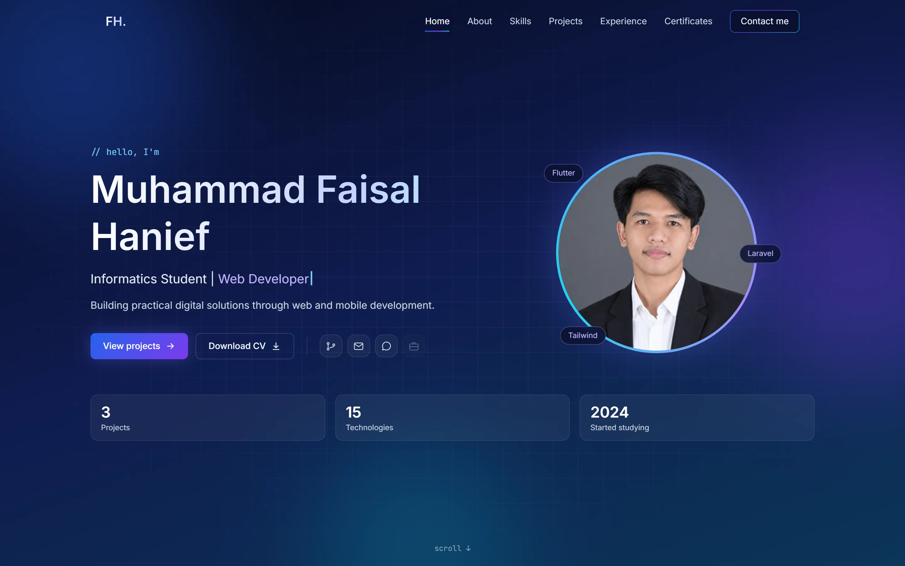
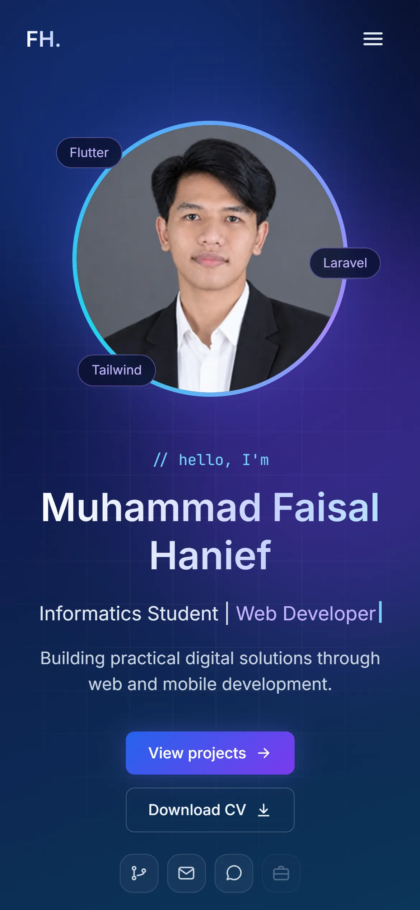

# Portfolio Website

Personal portfolio website of **Muhammad Faisal Hanief**, an Informatics student at Universitas Teknokrat Indonesia. Built with Laravel 12, Tailwind CSS v4, and MySQL. Skills, projects, experience, and certificates on the page are loaded from the site's own REST API.

> Live demo: coming soon

| Desktop                                        | Mobile                                       |
| ---------------------------------------------- | -------------------------------------------- |
|  |  |

## Features

- Responsive dark design with a gradient background, intro loader, typing effect, scroll animations, and a cursor spotlight on project cards
- Sections: Hero, About, Skills, Projects, Experience & Education (timeline), Certificates, and Contact
- Skills, projects, experience, and certificates are loaded from a REST API (Laravel + MySQL), each with loading and error states
- Official technology logos bundled locally from the `devicon` package (no external requests)
- Contact form with server-side validation that saves messages to the database (rate limited)
- Token-based admin API (Laravel Sanctum) to update the profile, manage projects, and read messages
- Buttons for links that are not ready yet (for example LinkedIn) are shown as disabled instead of broken

## Tech stack

Laravel 12 · PHP 8.2+ · MySQL · Tailwind CSS v4 · Vite · Vanilla JavaScript · Laravel Sanctum

## Data model

Seven tables: `profiles`, `skills`, `projects`, `project_skill` (many-to-many pivot between projects and skills), `experiences`, `certificates`, and `messages`. The entity relationship diagram and table descriptions are in the [Latihan 4b branch](https://github.com/Faisal-Hanief/portfolio/tree/Lat-4b_DatabaseModel).

## API

| Method              | Endpoint                          | Access                | Description                                              |
| ------------------- | --------------------------------- | --------------------- | -------------------------------------------------------- |
| GET                 | `/api/profile`                    | Public                | Profile (email and phone are not exposed)                |
| GET                 | `/api/skills`                     | Public                | Skills grouped by category                               |
| GET                 | `/api/projects`                   | Public                | Projects with their skills                               |
| GET                 | `/api/projects/{slug}`            | Public                | One project                                              |
| GET                 | `/api/experiences`                | Public                | Education, work, and organization timeline               |
| GET                 | `/api/certificates`               | Public                | Certificates                                             |
| GET                 | `/api/stats`                      | Public                | Project and skill counts                                 |
| POST                | `/api/contact`                    | Public (5 per minute) | Save a contact message (name, email, subject, message)   |
| POST                | `/api/login`                      | Public (5 per minute) | Get an admin token                                       |
| POST                | `/api/logout`                     | Token                 | Revoke the current token                                 |
| PATCH               | `/api/profile`                    | Token                 | Update the profile (for example the CV or LinkedIn link) |
| POST, PATCH, DELETE | `/api/projects`                   | Token                 | Create, update, and delete projects                      |
| GET                 | `/api/contact-messages`           | Token                 | Read contact messages                                    |
| PATCH               | `/api/contact-messages/{id}/read` | Token                 | Mark a message as read                                   |

Admin endpoints need an `Authorization: Bearer <token>` header. Tokens expire after one day.

## Getting started

Requirements: PHP 8.2+, Composer, Node.js 20.19+ (or 22.12+), and MySQL.

```bash
git clone https://github.com/Faisal-Hanief/portfolio.git
cd portfolio
composer install
npm install
cp .env.example .env        # on Windows: copy .env.example .env
php artisan key:generate
```

Create an empty MySQL database named `portofolio_web` and check the `DB_*` values in `.env`. Then set:

- `ADMIN_EMAIL` and `ADMIN_PASSWORD` for the admin account (use a strong, unique password)
- `PORTFOLIO_EMAIL`, `PORTFOLIO_GITHUB`, `PORTFOLIO_WHATSAPP`, `PORTFOLIO_LINKEDIN`, and `PORTFOLIO_CV` (optional). These values are copied into the `profiles` table when you run the seeder. Change them later with `PATCH /api/profile`.

```bash
php artisan migrate:fresh --seed
npm run build
```

Open the site in your local web server (for example Laragon, or `php artisan serve`). For development, run `npm run dev` instead of `npm run build`.

## Notes

- Never commit your `.env` file. Use `.env.example` as the template.
- Tailwind CSS v4 is configured in `resources/css/app.css`, so there is no `tailwind.config.js` file.
- After changing CSS or JavaScript for production, run `npm run build`.

## Course milestones (Pemrograman Web 2)

|                  |                        |
| ---------------- | ---------------------- |
| Name             | Muhammad Faisal Hanief |
| Student ID (NPM) | 24312201               |
| Class            | IF 24 B                |

- [Latihan 4a: Setup Laravel and MySQL](https://github.com/Faisal-Hanief/portfolio/tree/Lat-4a_SetupLaravel)
- [Latihan 4b: Database migration, models, and seeder](https://github.com/Faisal-Hanief/portfolio/tree/Lat-4b_DatabaseModel)

## License

Personal portfolio project. All rights reserved.
