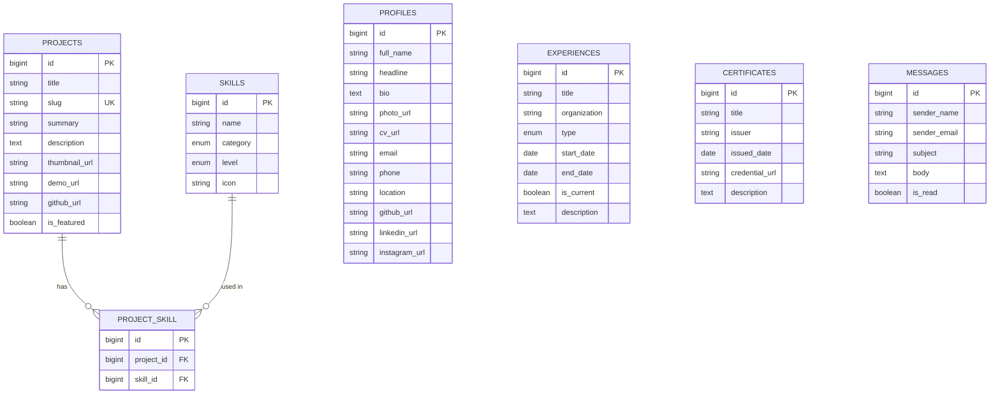
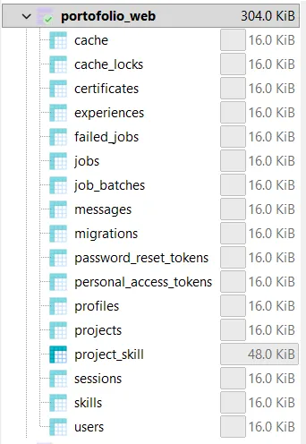
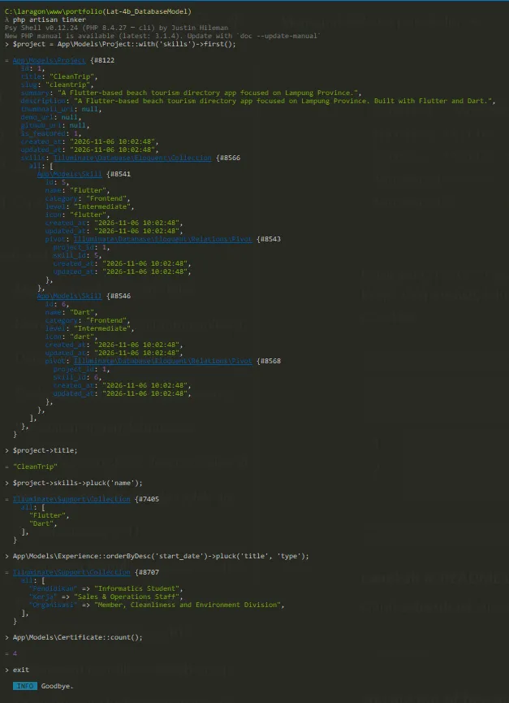

# Latihan 4b: Database Migration, Model Eloquent, dan Seeder

|        |                        |
| ------ | ---------------------- |
| Nama   | Muhammad Faisal Hanief |
| NPM    | 24312201               |
| Kelas  | IF 24 B                |
| Branch | `Lat-4b_DatabaseModel` |

Studi kasus: website portofolio mahasiswa. Latihan ini membangun skema database 7 tabel, model Eloquent beserta relasinya, dan seeder data portofolio.

## Diagram relasi (ERD)



## Penjelasan tabel

| Tabel           | Fungsi                                                                                                                      |
| --------------- | --------------------------------------------------------------------------------------------------------------------------- |
| `profiles`      | Satu baris identitas dan kontak pemilik portofolio                                                                          |
| `skills`        | Keahlian. `category` bertipe enum (Frontend, Backend, Database, Tools) dan `level` bertipe enum dengan default Intermediate |
| `projects`      | Proyek. Kolom `slug` bersifat unik                                                                                          |
| `project_skill` | Tabel pivot proyek dan skill (many-to-many). Dua foreign key dengan `onDelete('cascade')`                                   |
| `experiences`   | Timeline pendidikan, organisasi, magang, dan pekerjaan. `type` bertipe enum                                                 |
| `certificates`  | Sertifikat dan penghargaan                                                                                                  |
| `messages`      | Pesan dari form kontak. `is_read` bertipe boolean                                                                           |

Relasi: `projects` dan `skills` berhubungan many-to-many lewat `project_skill`. Tabel `profiles`, `experiences`, `certificates`, dan `messages` berdiri sendiri.

## Model dan proteksi mass assignment

- `Project::skills()` dan `Skill::projects()` memakai `belongsToMany(..., 'project_skill')`.
- Model master (`Profile`, `Skill`, `Project`, `Experience`, `Certificate`) memakai `$guarded = ['id']`, karena datanya diisi oleh seeder dan admin.
- Model `Message` memakai `$fillable` (daftar putih), karena menerima input langsung dari pengunjung website. Kolom lain seperti `is_read` otomatis diabaikan walaupun dikirim dari luar.

## Seeder

`PortfolioSeeder` mengisi: 1 profil, 15 skill (4 kategori), 3 proyek yang terhubung ke skill lewat `sync()`, 3 pengalaman (pendidikan, pekerjaan, organisasi), dan 4 sertifikat. Data kontak pribadi (email dan telepon) dibaca dari file `.env`, sehingga tidak tersimpan di repositori.

## Bukti pengerjaan

Daftar tabel di MySQL (`portofolio_web`):



Pengujian relasi dengan Artisan Tinker:



## Cara menjalankan

```bash
composer install
npm install
copy .env.example .env
php artisan key:generate
```

Buat database kosong `portofolio_web`, isi nilai `DB_*`, `ADMIN_EMAIL`, dan `ADMIN_PASSWORD` di `.env`, lalu:

```bash
php artisan migrate:fresh --seed
```

## Keamanan

- File `.env` tidak diunggah. Yang diunggah hanya `.env.example`.
- Migrasi diulang dengan `php artisan migrate:fresh --seed`, bukan dengan mengubah tabel secara manual.
